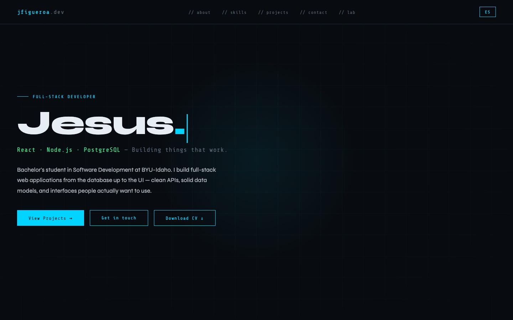

# jfigueroa.dev

Personal portfolio of **Jesus Figueroa** — full-stack developer pursuing a
Bachelor's in Software Development at BYU-Idaho.

**Live:** <https://jfigueroa.dev>

[](https://jfigueroa.dev)

## What's inside

- **Portfolio** — about, skills, projects and contact. Bilingual (EN/ES), with
  the chosen language remembered between visits.
- **Lab** (`/lab`) — small, self-contained apps:
  - **Pit Wall** (`/lab/f1`) — Formula 1 calendar, race, sprint and qualifying
    results, and driver and constructor standings for every season since 1950,
    via the public [Jolpica-F1](https://github.com/jolpica/jolpica-f1) API.
    Written in TypeScript, with a client-side request limit and two cache layers.
    See its [README](src/pages/lab/f1/README.md).
  - **Matchday** (`/lab/football`) — standings, fixtures and results from
    Europe's top five leagues, the Champions League and the Copa Libertadores via
    [football-data.org](https://www.football-data.org). The API key stays on the
    server behind a Vercel Function. See its
    [README](src/pages/lab/football/README.md).
  - **Loop** (`/lab/todo`) — task manager with editing, filters and
    persistence (`useReducer` + `localStorage`).

## Stack

React 19 · React Router 7 · Vite · TypeScript (Pit Wall) · plain CSS ·
Vercel Functions · Vitest + Testing Library

## Getting started

```bash
npm install
cp .env.example .env.local   # add your football-data.org API key
npm run dev
```

| Script | Description |
|---|---|
| `npm run dev` | Dev server (includes the `/api/football` and `/api/f1` proxies) |
| `npm run build` | Production build into `dist/` |
| `npm run preview` | Serve the production build locally |
| `npm test` | Run the test suite |
| `npm run lint` | Lint with ESLint |
| `npm run typecheck` | Type-check the TypeScript code with `tsc` |

## Deployment

Deployed on Vercel. Set `FOOTBALL_DATA_API_KEY` in *Project Settings →
Environment Variables*. `vercel.json` rewrites client-side routes to
`index.html`; `/api/*` is served by Vercel Functions.

## Project structure

```
api/                    Vercel Functions (football-data.org and Jolpica-F1 proxies)
docs/                   README screenshot · cv/ (CV source + build script)
public/                 Static assets (CV, favicon, social preview image)
src/
  components/           Navbar, footer, 404 and error pages
  context/              Language (EN/ES) provider
  data/content.js       All site copy, in English and Spanish
  hooks/                Reusable hooks
  pages/lab/            Lab apps (f1, football, todo)
  sections/             Home page sections
  styles/               One stylesheet per section/page
```
